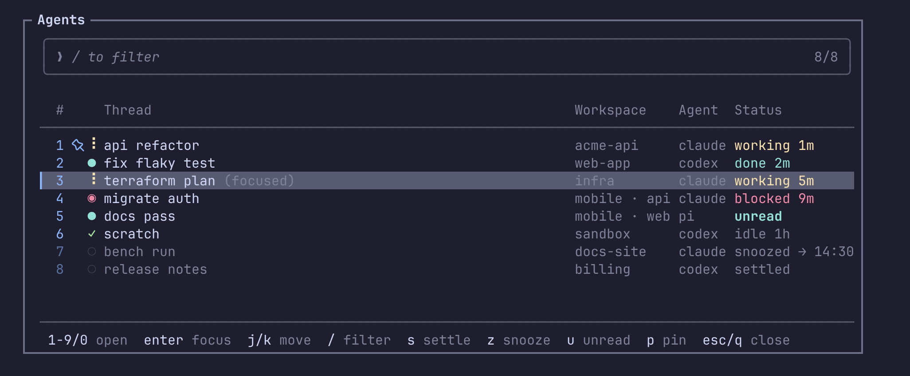
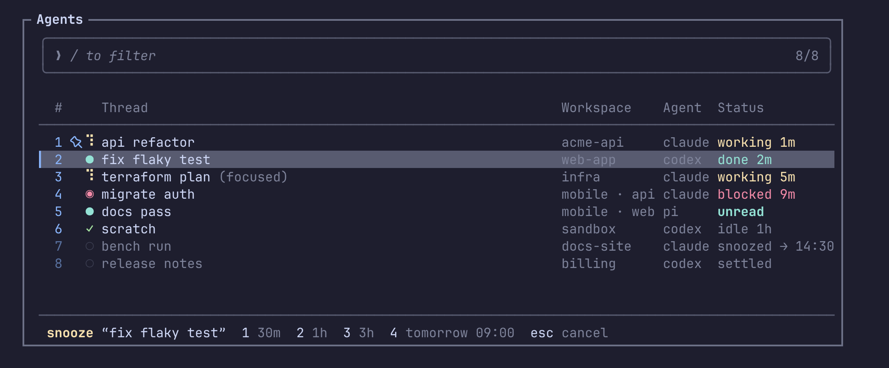

# herdr-triage

An agent picker for [Herdr](https://herdr.dev) with T3 Code-style triage. Finished threads can be
**settled** out of the way, **snoozed** until later, marked **unread**, or **pinned** to the top.
Settling an agent closes its pane, unless it is the last pane in its workspace or Herdr can neither
tell its state nor resume it. If Herdr can resume
its session (Claude, OpenCode, Pi, or Codex run with `--no-daemon`), snoozing closes it too, and the
thread stays in the picker and reopens with its conversation
when you unsettle, wake or open it. Herdr's native Agents sidebar
follows the same order and hides parked threads.



## Install

Requires Herdr 0.9.1+, Git, a Rust toolchain (`cargo`) and a C compiler (for the bundled SQLite;
Xcode Command Line Tools on macOS) on Linux or macOS.

```sh
herdr plugin install aryan-binazir/herdr-triage
```

Bind the actions in `~/.config/herdr/config.toml`:

```toml
[keys]
next_agent = "prefix+]"        # follow the triage order
previous_agent = "prefix+\\"

[[keys.command]]
key = "prefix+a"
type = "plugin_action"
command = "ar.triage.open"
description = "agent triage picker"

[[keys.command]]
key = "prefix+w"
type = "plugin_action"
command = "ar.triage.next"
description = "next agent that needs you"
```

To show pin and unread marks in the sidebar, add the `$triage` token to your agent rows, for example:

```toml
[ui.sidebar.agents]
rows = [
  ["state_icon", "machine", "workspace", "tab"],
  ["agent", { token = "$triage", rules = [
    { contains = "unread", bold = true },
    { contains = "woke", bold = true },
  ] }],
]
```

## Picker keys

| Key | List | While typing a search |
| --- | --- | --- |
| `j`/`k`, `↑`/`↓` | move (wraps) | `^j`/`^k`, `↑`/`↓` move |
| `enter` | focus agent · reopen closed thread · open/close section | same |
| `1`–`9`, `0` | open row 1–10 on screen | typed |
| `/` | search (edits the kept search) | — |
| `s` | settle / unsettle (asks first if it would close an agent for good) | typed |
| `z` | snooze (1h, 3h, today 18:00, tomorrow 09:00, next Mon 09:00; press the digit shown beside one) / wake | typed |
| `u` | mark read / unread | typed |
| `p` | pin / unpin | typed |
| `r` | rename the thread (`enter` saves; an empty title restores the automatic one) | typed |
| `U` | undo the last triage change or rename (the footer names it, e.g. `U undo settle “docs pass”`) | typed |
| `D` | forget a closed thread (asks `y`) | typed |
| `esc` | clear the search, else close | leave search, keeping it |
| `q` | close (cancels an open prompt) | typed |
| `^u` / `^w` | — | clear / delete word |

The picker opens on the agent you invoked it from. Agents busy working (unless pinned) collect in a
`▸ working · N` section below the threads that need you; snoozed and settled threads collect in
`▸ snoozed · N` and `▸ settled · N` sections at the bottom. Sections stay collapsed until you open
them, and the picker remembers which are open. A search looks inside them too. After you settle or
snooze a thread, the cursor moves on to the next one that needs you: blocked first, then done or
unread. `z` swaps the footer for a snooze prompt; pick a time with the digit beside it, or `esc`/`q`
to cancel. Each time keeps its digit: from 30 minutes before 18:00, `today 18:00` is crossed out
and refused. A time that has passed while the prompt was open is refused too:



## Triage rules

- **Order:** pinned → open threads by most recent status change → snoozed (soonest to wake first) →
  settled. Closed threads follow live ones by last activity.
- **Pin and settle** exclude each other, as in T3 Code: settling unpins a thread, and pinning a
  parked thread brings it back. A parked thread sinks even when pinned.
- **Blocked, working, done, idle** are Herdr's own states. *Done* means finished and not yet viewed.
- **Settle** (`s`) marks the thread read and parks it until it does something new (Herdr's change
  counter advancing).
- **Snooze** (`z`) parks it until the chosen time; then it returns marked *woke*. The picker shows
  the time left (`snoozed · 45m`). An agent that blocks on you wakes early; other activity, including
  a snoozed agent finishing its work, does not. Viewing the agent clears *woke*.
- **Closing:** settling an agent closes its pane. If Herdr can resume its session (Claude, Codex,
  OpenCode or Pi with Herdr's integration), the thread stays listed as closed and snoozing closes
  it too. Settling an agent with no session to resume first asks: `y` closes it for good (Herdr
  notifies you, the thread leaves the picker and undo can't bring it back), `n` settles it and
  keeps its pane open. Snoozing one, or settling one whose
  state Herdr can't tell (`unknown`), leaves it open, as does snoozing an agent that is still
  working, and so does the last pane of a workspace; these are marked `stays open`. Codex only reports its session to Herdr when it runs without its shared
  app-server: start it with `codex --no-daemon` (or alias `codex` to that).
- **After a Herdr restart,** Herdr relaunches restored agents; state changes in the first 20 seconds
  are not treated as new activity, so parked threads stay parked.
- **Reopening:** unsettling, waking or opening a closed thread starts a new tab in its workspace (or
  the current one, if that workspace is gone) and runs `claude --resume <id>`, `codex resume <id>`,
  `opencode --session <id>` or `pi --session <id>`. A closed snooze that comes due shows as
  `woke · closed` and waits for you. OpenCode uses its configured server and creates a session if
  the saved ID no longer exists; reopening does not recover deleted conversation history.
  Herdr accepting the launch command does not guarantee that the application starts successfully;
  application errors remain visible in the new tab.
- **Unread** (`u`) on a done or unread thread marks it read without visiting it; on any other it marks
  it unread until you press `u` again, the agent's next turn, or you read it: go to another agent and
  come back to it, or reopen it if it was closed. Marking a parked thread unread brings it back
  without reopening it.
- A thread whose session ends some other way settles as closed, even if you hadn't seen its result,
  unless you marked it unread or a snooze woke it: then it stays open as `unread · closed` or
  `woke · closed`. Settle and unread are refused while an agent is working or blocked;
  snooze only while it is blocked.
- **Undo** (`U`) takes back the last settle, snooze, wake, unread, pin or rename, once. It never closes
  a pane; undoing a settle or snooze that closed a session reopens it, unless it closed for good.
  Once the agent has done
  something new, undo can still bring a thread back but won't park it again. Forgetting a thread
  can't be undone.
- **Rename** (`r`) gives a thread its own title in the picker; search still finds the automatic one.
- **`next`** focuses blocked agents first, then done or unread ones, skipping parked and closed threads.

Closed threads are forgotten after 30 days untouched unless pinned; `D` forgets one now. Agents
without a resumable session are forgotten once they exit.

## T3 Code threads

If [T3 Code](https://github.com/pingdotgg/t3code) runs on this machine, the picker also lists its
threads, so one list shows everything that needs you. A T3 thread still lives only in T3: its row
points at it, and `enter` (or its digit) opens it in the T3 desktop app through its
`t3code://threads/…` link (`xdg-open` on Linux, `open` on macOS).

- Rows show T3's own state in the picker's words: running is *working*, waiting on you is
  *blocked*, a finished run you haven't opened since is *done*, otherwise *idle*. T3's settles,
  snoozes and pins place the row as Herdr's do; working threads join the `working` section.
- T3 rows follow the Herdr rows of the same rank, newest first; snoozed rows of either kind wake
  in order. Settled T3 threads untouched for 30 days are left out. Subagent and side-chat
  threads stay under their parent, as in T3.
- `s`, `z`, `p` and `u` on a T3 row have T3 settle or unsettle, snooze (same presets) or wake,
  pin or unpin, and mark unread the thread; the row moves once T3 has done it. T3 decides what it
  allows and the footer shows its answer, for example that a thread with no finished run can't be
  marked unread, or that settling a working thread waits for its turn to end. T3 marks a thread
  read when you open it. Rename and forget T3 threads in T3; `U` undoes Herdr changes only.
  `next` and the sidebar cover Herdr's agents only.
- The first change signs herdr-triage in to T3, with no browser: the local `t3` command issues a
  one-time pairing code (`t3 auth pairing create`), which approves herdr-triage at T3's `auto`
  access level. T3 then issues a 30-day token, kept owner-only in the plugin state directory
  (`t3-token.json`); when it expires or is revoked, the next change signs in again. `auto` lets
  herdr-triage change threads that run in `approval-required` to `auto` mode; T3 refuses changes
  to `full-access` threads. The token can also message threads, so treat the file like a T3
  login. See and revoke it with `t3 auth session list` and `t3 auth session revoke <id>`.
- The picker reads T3's database (`$T3CODE_HOME`, else `~/.t3`, at `userdata/statev2.sqlite`)
  read-only, every 2 seconds, on a thread of its own, which also sends the picker's changes to
  T3's server. Only this machine's T3 threads appear, not those of other T3 environments the app
  is connected to. If T3 isn't installed, isn't running, or an update reshapes its database, the
  picker shows no T3 rows (or keeps the last ones it read) and T3 changes fail with a message;
  Herdr's rows are unaffected.

## Sidebar

The plugin owns Herdr's Agents view while it is enabled. It hides snoozed and settled agents and
counts the snoozed ones in the header (`2 snoozed`); settled ones pile up for 30 days, so they are not
counted there. The picker lists both. Herdr's sort toggle is
disabled until the plugin is disabled. Each agent pane gets two tokens:

| Token | Values |
| --- | --- |
| `triage_rank` | `0` pinned, `1` open, `2` snoozed, `3` settled |
| `triage` | pin icon, `unread`, `woke`, or nothing |

The sidebar only displays triage; act on agents from the picker. Marking a done agent read in the
picker cannot clear Herdr's own done icon in the sidebar; viewing the agent does.

## Configuration

`~/.config/herdr/plugins/config/ar.triage/config.toml`:

```toml
pin_icon = ""   # default: Nerd Font nf-oct-pin (U+F435); use any text without a Nerd Font
```

## How it works

There is no resident daemon. Hooks never touch T3; only the open picker reads it or sends it changes. Herdr runs `herdr-triage sync` on agent status changes, focus changes,
agent detection and pane exits (a hook that finds a sync already running asks it to sync again and
exits, since Herdr rejects plugin commands beyond 32 at once); each sync reconciles threads with `agent.list`, then, under a file lock,
reports tokens wherever Herdr's copy differs and sets the Agents view. A startup hook does the same after
a server restart. Each snooze starts a detached sleeper that syncs once its wake time has passed.

Threads live in a SQLite database in Herdr's plugin state directory, one per Herdr server. Triage saved
by earlier versions (`state.json`) is imported once.

Herdr doesn't run startup hooks on install or enable, so the sidebar adopts the triage order at the
first agent event or the first time you open the picker.

## Development

```sh
mise install    # pinned Rust and lefthook
make check      # fmt, clippy, tests
make bench      # release performance table + target/bench/latest.json (under 2 min after build)
```

Optional pre-push checks use the same gate:

```sh
lefthook install
RUN_PRE_PUSH_CHECKS=1 git push
```

Default pushes skip verification. Verification runs locally; this repository has no GitHub Actions workflows.
Integration tests run the binary against a fake Herdr socket.
