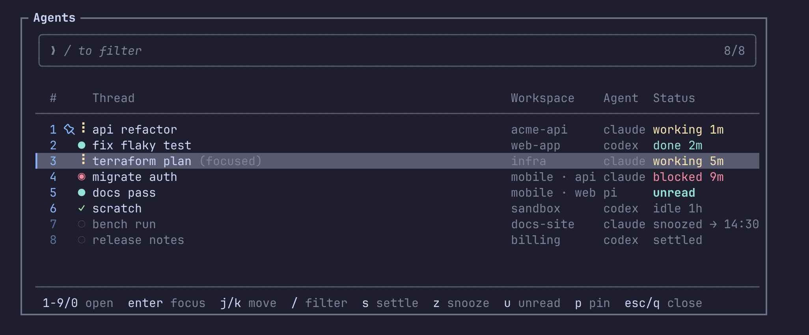
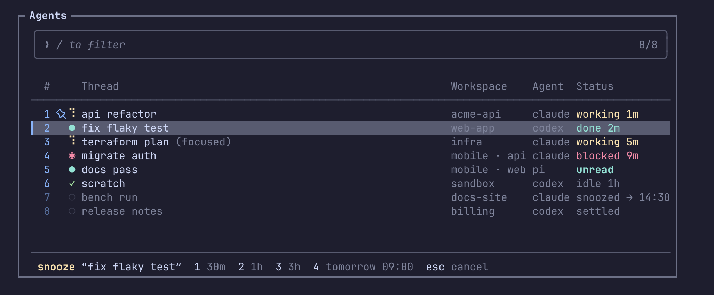

# herdr-triage

An agent picker for [Herdr](https://herdr.dev) with T3 Code-style triage. Finished threads can be
**settled** out of the way, **snoozed** until later, marked **unread**, or **pinned** to the top.
Settling or snoozing an agent whose session Herdr can resume (Claude, Pi, or Codex run with
`--no-daemon`) closes its session, unless it is the last pane in its workspace; the thread stays in the picker and reopens with its conversation
when you unsettle, wake or open it. Herdr's native Agents sidebar
follows the same order and hides parked threads.



## Install

Requires Herdr 0.9.1+, Git, a Rust toolchain (`cargo`) and a C compiler (for the bundled SQLite;
Xcode Command Line Tools on macOS) on Linux or macOS.

```sh
herdr plugin install aryan-binazir/herdr-triage
```

Bind the actions in `~/.config/herdr/config.toml`:

```toml
[keys]
next_agent = "prefix+]"        # follow the triage order
previous_agent = "prefix+\\"

[[keys.command]]
key = "prefix+a"
type = "plugin_action"
command = "ar.triage.open"
description = "agent triage picker"

[[keys.command]]
key = "prefix+w"
type = "plugin_action"
command = "ar.triage.next"
description = "next agent that needs you"
```

To show pin and unread marks in the sidebar, add the `$triage` token to your agent rows, for example:

```toml
[ui.sidebar.agents]
rows = [
  ["state_icon", "machine", "workspace", "tab"],
  ["agent", { token = "$triage", rules = [
    { contains = "unread", bold = true },
    { contains = "woke", bold = true },
  ] }],
]
```

## Picker keys

| Key | List | While typing a search |
| --- | --- | --- |
| `j`/`k`, `↑`/`↓` | move (wraps) | `^j`/`^k`, `↑`/`↓` move |
| `enter` | focus agent · reopen closed thread · open/close section | same |
| `1`–`9`, `0` | open row 1–10 on screen | typed |
| `/` | search (edits the kept search) | — |
| `s` | settle / unsettle | typed |
| `z` | snooze (`1` 1h, `2` 3h, `3` today 18:00, `4` tomorrow 09:00, `5` next Mon 09:00) / wake | typed |
| `u` | mark read / unread | typed |
| `p` | pin / unpin | typed |
| `r` | rename the thread (`enter` saves; an empty title restores the automatic one) | typed |
| `U` | undo the last triage change or rename | typed |
| `D` | forget a closed thread (asks `y`) | typed |
| `esc` | clear the search, else close | leave search, keeping it |
| `q` | close | typed |
| `^u` / `^w` | — | clear / delete word |

The picker opens on the agent you invoked it from. Agents busy working (unless pinned) collect in a
`▸ working · N` section below the threads that need you; snoozed and settled threads collect in
`▸ snoozed · N` and `▸ settled · N` sections at the bottom. Sections stay collapsed until you open
them, and the picker remembers which are open. A search looks inside them too. After you settle or
snooze a thread, the cursor moves on to the next one that needs you: blocked first, then done or
unread. `z` swaps the footer for a snooze prompt; pick a time with its digit (`today 18:00` is
offered until 30 minutes before):



## Triage rules

- **Order:** pinned → open threads by most recent status change → snoozed (soonest to wake first) →
  settled. Closed threads follow live ones by last activity.
- **Pin and settle** exclude each other, as in T3 Code: settling unpins a thread, and pinning a
  parked thread brings it back. A parked thread sinks even when pinned.
- **Blocked, working, done, idle** are Herdr's own states. *Done* means finished and not yet viewed.
- **Settle** (`s`) marks the thread read and parks it until it does something new (Herdr's change
  counter advancing).
- **Snooze** (`z`) parks it until the chosen time; then it returns marked *woke*. The picker shows
  the time left (`snoozed · 45m`). An agent that blocks on you wakes early; other activity, including
  a snoozed agent finishing its work, does not. Viewing the agent clears *woke*.
- **Closing:** settling or snoozing an agent whose session Herdr can resume (Claude, Codex or Pi with
  Herdr's integration) closes its pane. Other agents, agents still working when snoozed, and the last
  pane of a workspace stay open and are marked `stays open`. Codex only reports its session to Herdr when it runs without its shared
  app-server: start it with `codex --no-daemon` (or alias `codex` to that).
- **After a Herdr restart,** Herdr relaunches restored agents; state changes in the first 20 seconds
  are not treated as new activity, so parked threads stay parked.
- **Reopening:** unsettling, waking or opening a closed thread starts a new tab in its workspace (or
  the current one, if that workspace is gone) and runs `claude --resume <id>`, `codex resume <id>` or
  `pi --session <id>`. A closed snooze that comes due shows as `woke · closed` and waits for you.
- **Unread** (`u`) on a done or unread thread marks it read without visiting it; on any other it marks
  it unread until you press `u` again or the agent's next turn. Marking a parked thread unread brings
  it back without reopening it.
- A thread whose session ends some other way settles as closed, or stays open as `unread · closed`
  if you hadn't seen its result. Settle and unread are refused while an agent is working or blocked;
  snooze only while it is blocked.
- **Undo** (`U`) takes back the last settle, snooze, wake, unread, pin or rename, once. It never closes
  a pane; undoing a settle or snooze that closed a session reopens it. Forgetting a thread can't be
  undone.
- **Rename** (`r`) gives a thread its own title in the picker; search still finds the automatic one.
- **`next`** focuses blocked agents first, then done or unread ones, skipping parked and closed threads.

Closed threads are forgotten after 30 days untouched unless pinned; `D` forgets one now. Agents
without a resumable session are forgotten once they exit.

## Sidebar

The plugin owns Herdr's Agents view while it is enabled. It hides snoozed and settled agents and
counts them in the header (`3 settled`, `2 snoozed`, or `5 parked` when both); the picker lists them. Herdr's sort toggle is
disabled until the plugin is disabled. Each agent pane gets two tokens:

| Token | Values |
| --- | --- |
| `triage_rank` | `0` pinned, `1` open, `2` snoozed, `3` settled |
| `triage` | pin icon, `unread`, `woke`, or nothing |

The sidebar only displays triage; act on agents from the picker. Marking a done agent read in the
picker cannot clear Herdr's own done icon in the sidebar; viewing the agent does.

## Configuration

`~/.config/herdr/plugins/config/ar.triage/config.toml`:

```toml
pin_icon = ""   # default: Nerd Font nf-oct-pin (U+F435); use any text without a Nerd Font
```

## How it works

There is no resident daemon. Herdr runs `herdr-triage sync` on agent status changes, focus changes,
agent detection and pane exits (a hook that finds a sync already running asks it to sync again and
exits, since Herdr rejects plugin commands beyond 32 at once); each sync reconciles threads with `agent.list`, then, under a file lock,
reports tokens wherever Herdr's copy differs and sets the Agents view. A startup hook does the same after
a server restart. Each snooze starts a detached sleeper that syncs once its wake time has passed.

Threads live in a SQLite database in Herdr's plugin state directory, one per Herdr server. Triage saved
by earlier versions (`state.json`) is imported once.

Herdr doesn't run startup hooks on install or enable, so the sidebar adopts the triage order at the
first agent event or the first time you open the picker.

## Development

```sh
mise install    # pinned Rust and lefthook
make check      # fmt, clippy, tests
```

Optional pre-push checks use the same gate:

```sh
lefthook install
RUN_PRE_PUSH_CHECKS=1 git push
```

Default pushes skip verification. Verification runs locally; this repository has no GitHub Actions workflows.
Integration tests run the binary against a fake Herdr socket.
